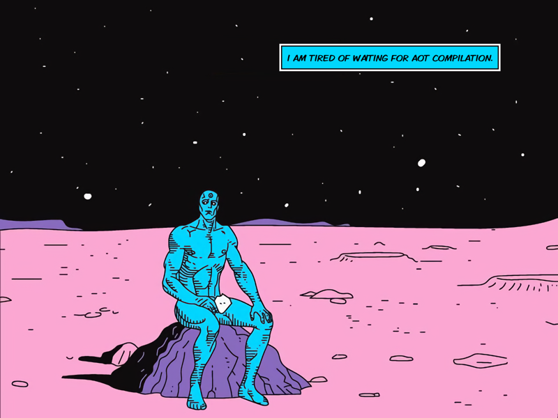

# Tired Manhattan Twitter Bot and Image Generator

Check it out: https://codemonkey85.github.io/TiredDoctorManhattan/

[](https://github.com/codemonkey85/TiredDoctorManhattan/actions/workflows/main.yml)

[](https://github.com/codemonkey85/TiredDoctorManhattan/actions/workflows/pages/pages-build-deployment)

[](https://codemonkey85.github.io/TiredDoctorManhattan/waiting%20for%20aot%20compilation)

Original repo: https://github.com/khalidabuhakmeh/TiredDoctorManhattan

## Build and test

Install the .NET 11 SDK selected by `global.json`, then run:

```sh
dotnet workload restore
dotnet build TiredDoctorManhattan.sln
dotnet test TiredDoctorManhattan.sln --no-build
dotnet run --project TiredDoctorManhattan.Wasm
```

The generator tests run on the host runtime using the production generator source,
background image, and font. They check text normalization, PNG encoding, dimensions,
rendered text, and borders after resizing. Pull requests run the Debug build and
tests, plus a Release AOT publish and browser check using the configured license secret;
pushes to `main` also publish the AOT app and deploy to GitHub Pages.

The app retains AOT compilation, with `SixLabors.ImageSharp.Drawing` interpreted.
Its generic rasterizer currently traps in Mono WebAssembly AOT at
`DefaultRasterizer.Context.FlushBufferedRun<TRowHandler>`.
The project uses the .NET SDK's internal assembly interpretation hook for this
workaround; recheck it when upgrading the SDK or Drawing package. The browser test
generates two distinct PNGs from the published output to catch runtime regressions.

### Six Labors license for Release builds

The upgraded Six Labors packages require a valid license for Release builds.
Debug builds and tests can run without a key, with a licensing warning.
See the [Six Labors licensing instructions](https://docs.sixlabors.com/articles/imagesharp/index.html)
and [license application](https://licensing.sixlabors.com/).
For an assembly-scoped community key, include `TiredDoctorManhattan.Wasm` and
`TiredDoctorManhattan.Tests`.

Set `SIXLABORS_LICENSE_KEY` to the complete issued license string locally and add
the same value as the repository Actions secret `SIXLABORS_LICENSE_KEY` for deployment.
`Directory.Build.props` passes the environment variable to the package's license validator.
Alternatively, set the MSBuild property `SixLaborsLicenseFile` to a license file path.
License files are ignored by Git; keep private keys out of source control.

With a license configured, publish with:

```sh
dotnet publish TiredDoctorManhattan.Wasm/TiredDoctorManhattan.Wasm.csproj -c Release -o release --nologo
```

To test the published app in a browser (requires Node.js):

```sh
npm ci --prefix tests/browser
npm exec --prefix tests/browser -- playwright install chromium
node tests/browser/smoke.cjs release/wwwroot
```

## License

Copyright © 2022 khalidabuhakmeh

Permission is hereby granted, free of charge, to any person obtaining a copy of this software and associated documentation files (the “Software”), to deal in the Software without restriction, including without limitation the rights to use, copy, modify, merge, publish, distribute, sublicense, and/or sell copies of the Software, and to permit persons to whom the Software is furnished to do so, subject to the following conditions:

The above copyright notice and this permission notice shall be included in all copies or substantial portions of the Software.

THE SOFTWARE IS PROVIDED “AS IS”, WITHOUT WARRANTY OF ANY KIND, EXPRESS OR IMPLIED, INCLUDING BUT NOT LIMITED TO THE WARRANTIES OF MERCHANTABILITY, FITNESS FOR A PARTICULAR PURPOSE AND NONINFRINGEMENT. IN NO EVENT SHALL THE AUTHORS OR COPYRIGHT HOLDERS BE LIABLE FOR ANY CLAIM, DAMAGES OR OTHER LIABILITY, WHETHER IN AN ACTION OF CONTRACT, TORT OR OTHERWISE, ARISING FROM, OUT OF OR IN CONNECTION WITH THE SOFTWARE OR THE USE OR OTHER DEALINGS IN THE SOFTWARE.
